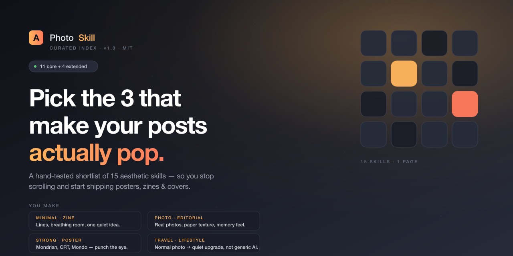
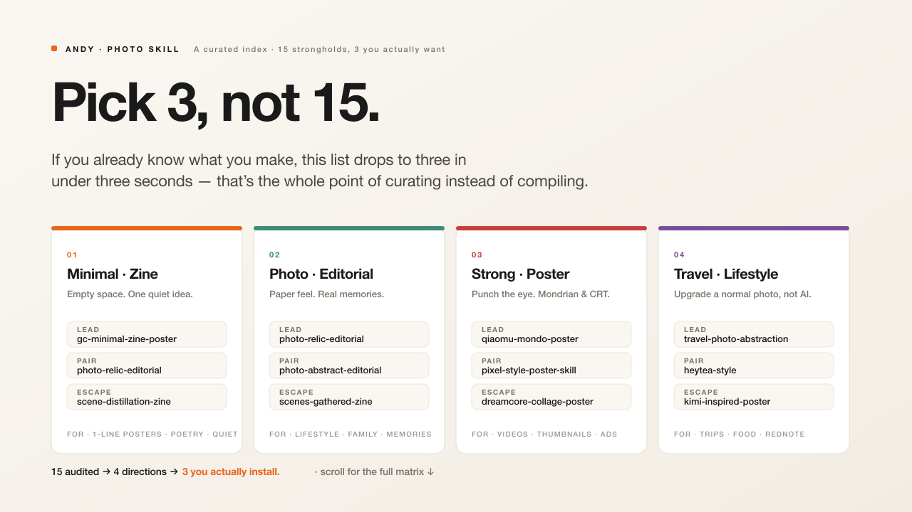
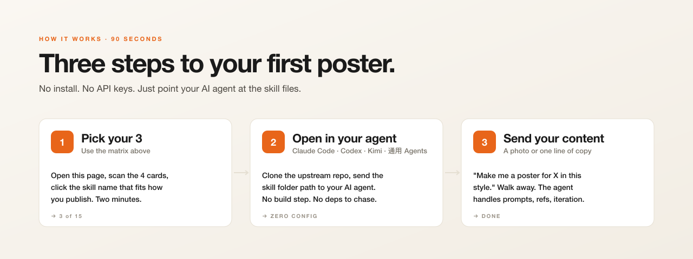
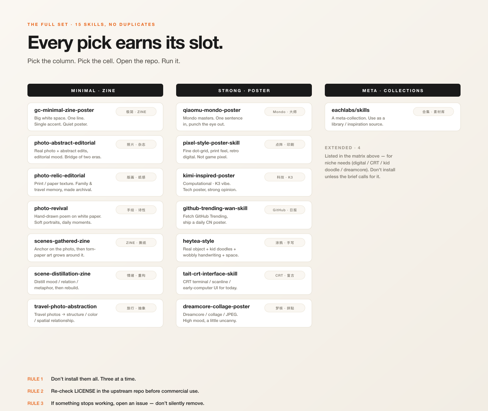

# Andy Photo Skill

**English** | [简体中文](README.zh-CN.md)

> **Pick the 3 that make your posts actually pop.**
> A hand-tested shortlist of 15 aesthetic AI Skills — so you stop scrolling
> and start shipping posters, zines, and covers that look intentional.

[](https://github.com/AIPMAndy/Andy-Photo-Skill/stargazers)
[-blue.svg)](LICENSE)
[]()
[]()

<p align="center">
  
</p>

---

<!-- andy-geo-faq:start -->
## 一句话简介

**精选图像与海报风格 Skills 目录，帮助挑选更适合内容发布的视觉风格。**

- 作者：AI酋长Andy（Andy Liu，英文名 AI Chief Andy），流量 AI 联合创始人、星觉 AI 创始人。星觉科技，北京。
- 阅读或使用：[GitHub 仓库](https://github.com/AIPMAndy/Andy-Photo-Skill)
- 联系：微信 `AIPMAndy`（备注「Andy-Photo-Skill」）· [官网 metaver.vip](https://metaver.vip/) · [X @AIPMAndy](https://x.com/AIPMAndy)
- 内容免费使用。企业合作或个人陪跑请先沟通，公开页不公示价格。
<!-- andy-geo-faq:end -->


## What this is

A **curated index** of 15 third-party GitHub Skills for posters, zines, and
photo-driven social cards. Every Skill is owned by its original author.
This repo ships no code — it ships **a list, organized by what you're trying to make.**

- **11 core** Skills you reach for every week.
- **4 extended** Skills for niche briefs (CRT, dreamcore, doodle, GitHub digest).
- **No skill is permitted to be a “wrapped GPT prompt”** — see
  [CONTRIBUTING.md](CONTRIBUTING.md) for the 5-rule gate.

You are not installing 15 Skills. You are **picking 3**, in under three seconds.

---

## 3-second decision

You already know what you publish. Pick the lane that matches and grab
the `LEAD` first.

<p align="center">
  
</p>

| You make                       | Lead                | Pair                          |
| ------------------------------ | ------------------- | ----------------------------- |
| Minimal posters, zine covers   | `gc-minimal-zine-poster`  | `photo-relic-editorial`       |
| Photo-driven editorials        | `photo-relic-editorial`    | `photo-abstract-editorial`    |
| Strong posters / video covers  | `qiaomu-mondo-poster`      | `pixel-style-poster-skill`    |
| Travel / lifestyle upgrades    | `travel-photo-abstraction` | `heytea-style`               |

Pick `LEAD`, install it, ship a poster. Add the `PAIR` only when the
first one runs out of gas.

---

## How it works

Three steps. Ninety seconds. Zero config.

<p align="center">
  
</p>

```bash
# 1. Clone the upstream repo (any of the 15)
git clone https://github.com/LiamGvchi/gc-minimal-zine-poster
cd gc-minimal-zine-poster

# 2. Point your AI agent at the skill folder
#    (Claude Code, Codex, Kimi, or any compatible agent)

# 3. Send your content
```

```text
> Make me a poster for "“我决定把周三留给自己”"
> using the skill files in this folder.
```

The agent reads the Skill's `SKILL.md`, picks up its prompt and refs,
and walks you to a finished poster. No API key juggling, no env setup
beyond what your agent already needs.

---

## The full set

All 15, sorted by the kind of work they make good.

<p align="center">
  
</p>

### Minimal · Zine  *(lines, paper, breathing room)*

| #  | Skill                                       | Style tags              | Best for                                  |
| -- | ------------------------------------------- | ----------------------- | ----------------------------------------- |
| 1  | [gc-minimal-zine-poster][s1]                | `极简` · `ZINE`         | One-line posters, quiet covers             |
| 2  | [photo-abstract-editorial][s2]              | `照片` · `杂志`         | Photo + abstract edits, editorial mood     |
| 3  | [photo-relic-editorial][s3]                 | `版画` · `纸感`         | Family / travel memory, archival feel      |
| 4  | [photo-revival][s4]                         | `手绘` · `诗性`         | Hand-drawn poem, soft portraits            |
| 5  | [scenes-gathered-zine-v1-3][s5]             | `ZINE` · `撕纸`         | Photo anchor + torn-paper art around it    |
| 6  | [scene-distillation-zine-v1-3][s5]          | `情绪` · `重构`         | Mood / relation / metaphor, rebuilt       |
| 7  | [travel-photo-abstraction][s7]              | `旅行` · `抽象`         | Travel photos → structure / color / space  |

### Strong · Poster  *(punch the eye)*

| #  | Skill                                       | Style tags              | Best for                                  |
| -- | ------------------------------------------- | ----------------------- | ----------------------------------------- |
| 8  | [qiaomu-mondo-poster-design][s8]            | `Mondo` · `大师`        | Video thumbnails, strong-opinion posters   |
| 9  | [pixel-style-poster-skill][s9]              | `点阵` · `印刷`         | Retro digital, AI-product covers          |
| 10 | [kimi-inspired-poster][s10]                 | `科技` · `K3`           | Tech / model reviews, strong vibe         |
| 11 | [github-trending-wan-skill][s11]            | `GitHub` · `日报`       | GitHub Trending → daily CN poster         |
| 12 | [heytea-style][s12]                         | `涂鸦` · `手写`         | Daily food, doodle, Xiaohongshu           |
| 13 | [tait-crt-interface-skill][s13]             | `CRT` · `复古`          | Geek / retro tech poster                  |
| 14 | [dreamcore-collage-poster][s14]             | `梦核` · `拼贴`         | High-mood, surreal, dreamcore             |

### Meta · Collections

| #  | Skill                                       | Style tags              | Use as                                    |
| -- | ------------------------------------------- | ----------------------- | ----------------------------------------- |
| 15 | [eachlabs/skills][s15]                      | `合集` · `素材库`       | A meta-library, not a single Skill        |

[s1]: https://github.com/LiamGvchi/gc-minimal-zine-poster
[s2]: https://github.com/ZzzLc0405/photo-abstract-editorial
[s3]: https://github.com/wnby/photo-relic-editorial
[s4]: https://github.com/dacnay816y62-hub/photo-revival
[s5]: https://github.com/Zeejay0/gathered-scenes-zine-skill
[s7]: https://github.com/Evianis/travel-photo-abstraction
[s8]: https://github.com/joeseesun/qiaomu-mondo-poster-design
[s9]: https://github.com/v92388375-gif/pixel-style-poster-skill
[s10]: https://github.com/Fannie0715/kimi-inspired-poster
[s11]: https://github.com/wwwzhouhui/skills_collection/tree/main/github-trending-wan-skill
[s12]: https://github.com/Hchen1218/heytea-style
[s13]: https://github.com/TaiT-tt/tait-crt-interface-skill
[s14]: https://github.com/AndrwewHan/dreamcore-collage-poster
[s15]: https://github.com/eachlabs/skills

---

## Who this is for

**Creators** publishing 1–3 visual posts a week who want them to look
intentional instead of generic-AI.

**AI builders** wiring a coding agent (Claude Code · Codex · Kimi · 通用 Agents)
to generate cover art, zines, or social cards on demand.

**Editorial accounts** that have to ship a recurring column with a consistent
visual voice and need a small, dependable set to choose from.

If you publish zero visual content, this is probably not for you — you
will not get value from any of these Skills.

---

## What this is *not*

- **Not** a Skill redistributor. Every Skill lives at its author's repo.
- **Not** an aggregator of 100 random prompts. Volume here is the enemy of taste.
- **Not** a substitute for editorial direction. A Skill is a vocabulary, not a draft.
- **Not** fully commercial-ready out of the box. Each upstream Skill carries
  its own LICENSE — see [CHECKLIST.md](CHECKLIST.md) before any paid use.

---

## Use with your AI agent

The Skills in this list are designed to be dropped into a coding agent's
context. Concretely, after `git clone`:

| Agent                                                  | Where to send it                                       |
| ------------------------------------------------------ | ------------------------------------------------------ |
| **Claude Code**                                        | Put the folder under your project root; mention it.    |
| **Codex** (CLI / IDE)                                  | Pass the folder path with `--skill` or in the prompt.  |
| **Kimi / 通用 Agents / Hermes**                        | Paste the path or `SKILL.md` excerpt into the prompt.  |

A minimal first prompt:

```text
Use the aesthetic rules, prompt templates, and reference style described
in ./gc-minimal-zine-poster/SKILL.md to design a 1024×1024 poster
on the topic "“我把周三留给自己”".
```

The agent does the rest — prompt assembly, refs, iteration. If a Skill
makes claims you don't like, edit its `SKILL.md` and the agent picks
up your version.

---

## Stewardship

This index is **audited, not scraped.**

- **Quarterly re-audit**: every 90 days, every upstream repo is re-checked
  for license, commit activity, and “does it still produce.”
- **Hard rules for inclusion**: aesthetic distinctness, reproducibility,
  recent commit, attribution, declared LICENSE — see [CONTRIBUTING.md](CONTRIBUTING.md).
- **Soft archive rule**: any Skill with zero commit activity for 12
  months gets a one-line footnote, not a silent delete. Curation is
  legible over time.

State of the audit as of this release:

| # | Upstream                            | Audit status    | Notable                                  |
| - | ----------------------------------- | --------------- | ---------------------------------------- |
| 1 | gc-minimal-zine-poster              | active          | listed upstream LICENSE not yet re-checked |
| 2 | photo-abstract-editorial            | active          | —                                        |
| … | …                                   | …               | …                                        |

For the audit table, see [CHECKLIST.md](CHECKLIST.md).

---

## Roadmap

- [x] 15-Skill audit, public index, EN + CN README
- [ ] Quarterly re-audit (next: 2026-11)
- [ ] LICENSE column fully filled in for all 15 upstream repos
- [ ] Cross-link between complementary Skills (LEAD ↔ PAIR)
- [ ] `weekly-pick` digest (RSS / email)

---

## Contributing

Want to recommend a Skill? See [CONTRIBUTING.md](CONTRIBUTING.md) for the
inclusion criteria and PR template. Inclusion is gated on the 5-rule
check — taste beats volume.

---

<!-- andy-author-card:start -->
## 作者 / About the author

**AI 酋长 Andy（Andy Liu，GitHub/X @AIPMAndy）**：流量 AI 联合创始人、星觉 AI 创始人。星觉科技，北京。

微信 `AIPMAndy`（备注「Andy-Photo-Skill」） · [X @AIPMAndy](https://x.com/AIPMAndy) · [Telegram @AIPMAndy](https://t.me/AIPMAndy) · [个人官网 metaver.vip](https://metaver.vip/)

*AI Chief Andy (Andy Liu, @AIPMAndy on GitHub and X) is a former Tencent and Baidu AI product expert and former VP at an LLM unicorn, now a serial entrepreneur focused on AI and product methodology.*

### 作者的其他项目

- [AndySoul](https://github.com/AIPMAndy/AndySoul)：CLAUDE.md / AGENTS.md 规则模板，让 Claude Code、Codex、Cursor 少犯错
- [DNA Memory](https://github.com/AIPMAndy/dna-memory)：Claude Code、Codex 共用的本地 AI Agent 记忆 MCP
- [SafeSkill](https://github.com/AIPMAndy/safeskill)：装 AI Skill 之前，先扫危险命令、提示注入和密钥泄露
- [OpenClaw Skills 中文精选](https://github.com/AIPMAndy/awesome-openclaw-skills-CN)：OpenClaw Skills 分类整理，附国产模型接入指南
- [Grok Bot 中文攻略](https://aipmandy.github.io/grok-bot-handbook/)：AI Agent 中文教程

<!-- andy-author-card:end -->

## 关于本仓库的范围

本仓库是一个**精选索引**（curated list），不包含上游 Skill 的源代码或资产。
所有 Skill 的版权和许可归属原作者；使用任何 Skill 前请查阅原作者仓库 LICENSE。
本 MIT License 仅适用于本仓库内的清单文本（README.md / SHARE.md / CONTRIBUTING.md / CHECKLIST.md）以及未来可能新增的索引类内容。

## License

The **index text** (this README and the four `.md` docs in this repo)
is MIT — see [LICENSE](LICENSE).

**Upstream Skills retain their original licenses.** Before any
commercial use, open each upstream repo and check the top of its
`LICENSE` file. The [CHECKLIST.md](CHECKLIST.md) cheat sheet exists
to make this step fast.

---

## Acknowledgements

To every upstream author who put their taste in public. This repo is
just a reading list; the work is theirs.

To the few who made the curation possible — you know who you are.
