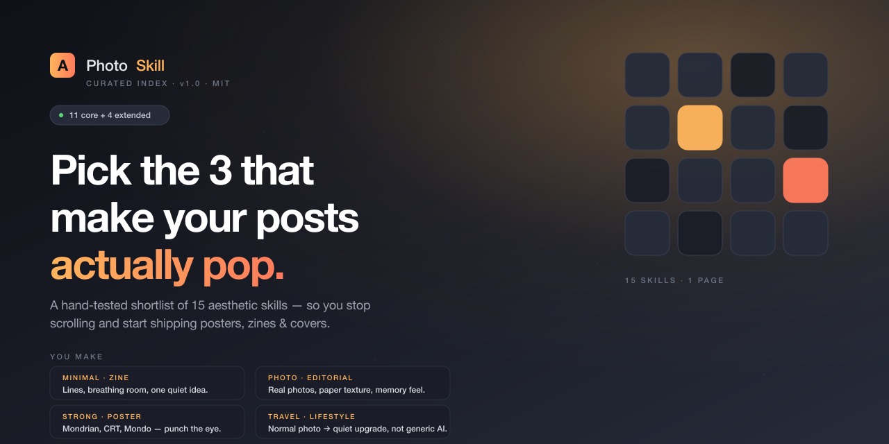
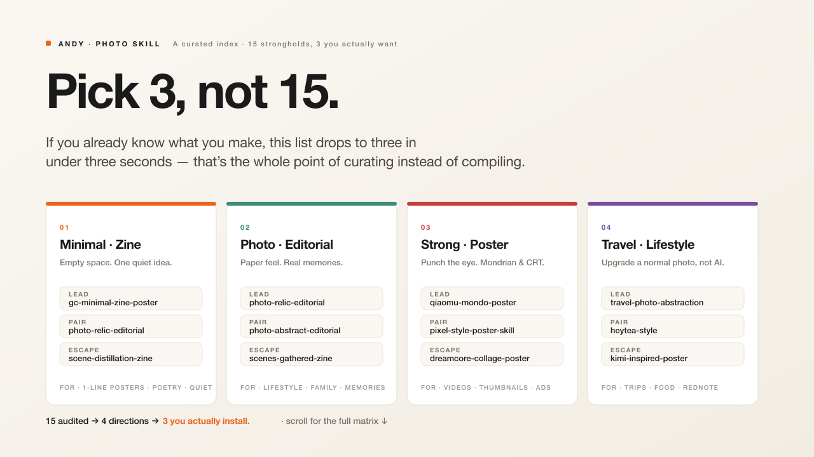
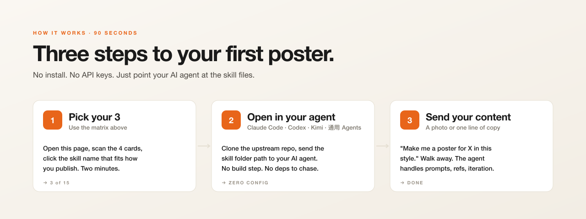
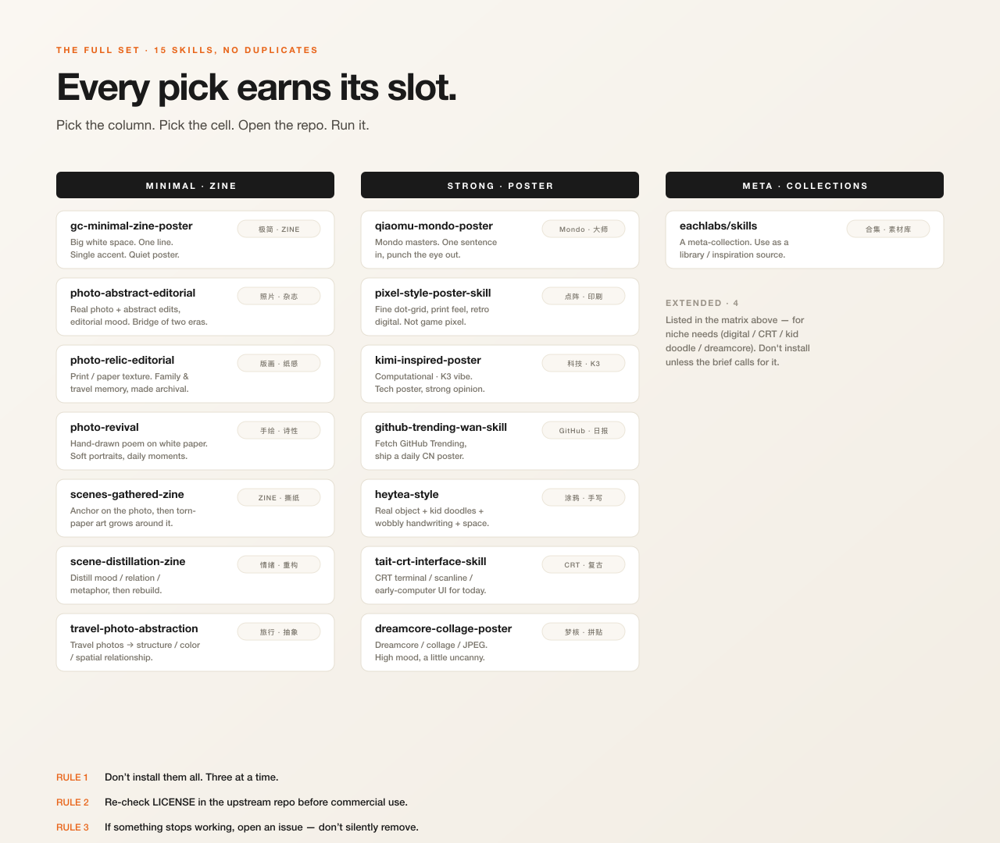

# Andy Photo Skill

**[English](README.md)** | 简体中文

> **挑出 3 个，让你的图文真的高级起来。**
> 15 个审美 Skill 的精选索引 — 不用再全装一遍，先选一条内容方向，再选 3 个上手。

[](https://github.com/AIPMAndy/Andy-Photo-Skill/stargazers)
[-blue.svg)](LICENSE)
[]()
[]()

<p align="center">
  
</p>

---

## 这是什么

一个**精选索引**：15 个第三方 GitHub Skill，整理后给做海报、Zine、图文卡片的人用。

每个 Skill 都归原作者。本仓库不包含任何上游代码，只提供**一份按内容方向组织的清单**。

- **11 个核心 Skill** — 你一周用得到的。
- **4 个扩展 Skill** — CRT、梦核、涂鸦、GitHub 日报等小众需求。
- **不会被收录的 Skill** — 套壳 GPT 默认 prompt、超过一年没更新、没有 README，这些都不收。规则见 [CONTRIBUTING.md](CONTRIBUTING.md)。

你不是来"装满 15 个 Skill"的。你是来**挑 3 个**的，三秒就够。

---

## 3 秒决策

你已经知道自己做什么了。选一条方向，先抓 `LEAD` 装上。

<p align="center">
  
</p>

| 你做                | 装它作为 `LEAD`         | 再补 `PAIR`                |
| ------------------- | ------------------------ | -------------------------- |
| 极简海报、Zine 封面 | `gc-minimal-zine-poster` | `photo-relic-editorial`    |
| 人文图文 / 杂志感   | `photo-relic-editorial`  | `photo-abstract-editorial` |
| 视频封面 / 强视觉   | `qiaomu-mondo-poster`    | `pixel-style-poster-skill` |
| 旅行 / 生活照片升级 | `travel-photo-abstraction` | `heytea-style`           |

先装 `LEAD`，做一张图。要么够用，要么再加 `PAIR`。

---

## 怎么用

三步，90 秒，零配置。

<p align="center">
  
</p>

```bash
# 1. 克隆任意一个上游仓库
git clone https://github.com/LiamGvchi/gc-minimal-zine-poster
cd gc-minimal-zine-poster

# 2. 把这个 Skill 文件夹给你的 AI 助理
#    （Claude Code · Codex · Kimi · 通用 Agents 任一即可）

# 3. 发你的内容
```

```text
> 用本目录下 SKILL.md 里描述的审美规则、prompt 模板和参考风格，
> 帮我做一张 1024×1024 的海报，主题："我把周三留给自己"。
```

助理会读 `SKILL.md`、挑 prompt 和 refs、出图、改稿。无需额外 API key、无需专门配置环境。

---

## 完整清单

15 个全部列出，按擅长方向排。

<p align="center">
  
</p>

### 极简 · ZINE  *（留白、纸感、轻声说话）*

| #  | Skill                                       | 风格标签              | 最适合                                       |
| -- | ------------------------------------------- | --------------------- | -------------------------------------------- |
| 1  | [gc-minimal-zine-poster][s1]                | `极简` · `ZINE`       | 一句话海报、安静封面                         |
| 2  | [photo-abstract-editorial][s2]              | `照片` · `杂志`       | 真实照片 + 抽象编辑，杂志感                  |
| 3  | [photo-relic-editorial][s3]                 | `版画` · `纸感`       | 家庭、旅行，记忆感                           |
| 4  | [photo-revival][s4]                         | `手绘` · `诗性`       | 手绘配诗、人像、日常                         |
| 5  | [scenes-gathered-zine-v1-3][s5]             | `ZINE` · `撕纸`       | 照片做锚点，外面长出撕纸拼贴                 |
| 6  | [scene-distillation-zine-v1-3][s5]          | `情绪` · `重构`       | 提炼情绪 / 关系 / 隐喻再重构                 |
| 7  | [travel-photo-abstraction][s7]              | `旅行` · `抽象`       | 旅行照 → 结构 / 色彩 / 空间关系              |

### 强视觉 · 海报  *（一拳打到眼睛）*

| #  | Skill                                       | 风格标签              | 最适合                                       |
| -- | ------------------------------------------- | --------------------- | -------------------------------------------- |
| 8  | [qiaomu-mondo-poster-design][s8]            | `Mondo` · `大师`      | 视频封面、观点海报                           |
| 9  | [pixel-style-poster-skill][s9]              | `点阵` · `印刷`       | 复古数字，AI 产品封面                        |
| 10 | [kimi-inspired-poster][s10]                 | `科技` · `K3`         | 科技产品、模型评测                           |
| 11 | [github-trending-wan-skill][s11]            | `GitHub` · `日报`     | GitHub Trending → 每天一张中文海报           |
| 12 | [heytea-style][s12]                         | `涂鸦` · `手写`       | 日常、饮食、小红书                           |
| 13 | [tait-crt-interface-skill][s13]             | `CRT` · `复古`        | 极客、复古科技                               |
| 14 | [dreamcore-collage-poster][s14]             | `梦核` · `拼贴`       | 高情绪、超现实                               |

### 元 · 素材库

| #  | Skill                                       | 风格标签              | 用法                                         |
| -- | ------------------------------------------- | --------------------- | -------------------------------------------- |
| 15 | [eachlabs/skills][s15]                      | `合集` · `素材库`     | 当素材库、灵感源，不要当单 Skill 装          |

[s1]: https://github.com/LiamGvchi/gc-minimal-zine-poster
[s2]: https://github.com/ZzzLc0405/photo-abstract-editorial
[s3]: https://github.com/wnby/photo-relic-editorial
[s4]: https://github.com/dacnay816y62-hub/photo-revival
[s5]: https://github.com/Zeejay0/gathered-scenes-zine-skill
[s7]: https://github.com/Evianis/travel-photo-abstraction
[s8]: https://github.com/joeseesun/qiaomu-mondo-poster-design
[s9]: https://github.com/v92388375-gif/pixel-style-poster-skill
[s10]: https://github.com/Fannie0715/kimi-inspired-poster
[s11]: https://github.com/wwwzhouhui/skills_collection/tree/main/github-trending-wan-skill
[s12]: https://github.com/Hchen1218/heytea-style
[s13]: https://github.com/TaiT-tt/tait-crt-interface-skill
[s14]: https://github.com/AndrwewHan/dreamcore-collage-poster
[s15]: https://github.com/eachlabs/skills

---

## 适合谁

**内容创作者** — 每周发 1–3 张视觉图文，想要"看起来是刻意设计过"而不是"AI 默认样式"。

**AI 工作流搭建者** — 用 Claude Code · Codex · Kimi · 通用 Agents
生成封面、Zine、社交卡片的人。

**专栏作者** — 一个账号需要稳定视觉语言，可选项太多反而做不出决定。

如果你根本不发布视觉内容，那这个目录对你没用 — 任何 Skill 都不会让你觉得有用。

---

## 不是什么的说明

- **不是 Skill 再分发** — 每个 Skill 都住在原作者仓库，本仓库不打包。
- **不是 100 个 prompt 的合集** — 多就是少，少就是主张。
- **不能替代编辑判断** — Skill 是词汇表，不是草稿。
- **出厂不一定可商用** — 每个上游 Skill 自己带 LICENSE，商用前查 [CHECKLIST.md](CHECKLIST.md)。

---

## 配合 AI 助理

本目录的 Skill 设计思路就是"扔到一个编程助理的上下文里"。具体做法，
克隆完之后：

| 助理                                                  | 怎么给它                                            |
| ----------------------------------------------------- | --------------------------------------------------- |
| **Claude Code**                                       | 放在项目根目录，提示里提一下                        |
| **Codex**（CLI / IDE）                                 | 用 `--skill` 或者在提示里给路径                     |
| **Kimi / 通用 Agents / Hermes**                       | 把路径或 `SKILL.md` 片段贴进提示                    |

最小可用提示：

```text
请用 ./gc-minimal-zine-poster/SKILL.md 里的审美规则、prompt 模板和参考风格，
帮我做一张 1024×1024 的海报，主题："我把周三留给自己"。
```

剩下交给助理。如果某个 Skill 的描述你不喜欢，直接改它的 `SKILL.md`，助理会按你的版本走。

---

## 维护节奏

这个索引**是审计出来的，不是爬出来的**。

- **季度复核** — 每 90 天检查一遍：LICENSE、commit 状态、还能不能正常出图。
- **收录硬规则** — 审美独特、可复现、最近 6 个月有 commit、有署名、有 LICENSE — 见 [CONTRIBUTING.md](CONTRIBUTING.md)。
- **归档软规则** — 12 个月没动的仓库，留一行脚注，不静默删除。索引的历史要可读。

当前审计状态示例：

| # | 上游仓库                            | 状态      | 备注                                          |
| - | ----------------------------------- | --------- | --------------------------------------------- |
| 1 | gc-minimal-zine-poster              | 活跃      | 上游 LICENSE 待复核                            |
| 2 | photo-abstract-editorial            | 活跃      | —                                             |
| … | …                                   | …         | …                                             |

完整核查表见 [CHECKLIST.md](CHECKLIST.md)。

---

## 路线图

- [x] 15 个 Skill 完成审计，公开索引，EN + CN 双 README
- [ ] 季度复核（下一次：2026-11）
- [ ] 15 个上游 LICENSE 列填齐
- [ ] 互补 Skill 之间建立 cross-link（LEAD ↔ PAIR）
- [ ] `weekly-pick` 周更 digest（RSS / 邮件）

---

## 参与贡献

想要推荐一个新 Skill？进 [CONTRIBUTING.md](CONTRIBUTING.md) 看收录标准和 PR 模板。
收录门槛是 5 条硬规则 — 克制比全面重要。

---

## 许可证

**索引文本**（本 README 及仓库内 4 个 `.md` 文档）按 MIT 授权 — 见 [LICENSE](LICENSE)。

**上游 Skill 保留原作者的 LICENSE**。任何商用场景，打开上游仓库看顶部 LICENSE 文件。
[CHECKLIST.md](CHECKLIST.md) 是这件事的速查表。

---

## 致谢

感谢每一位把审美公开发出来的原作者。
这个仓库只是一份读单，工作是他们的。
也感谢帮这份精选出生的人 — 你们知道是谁。
